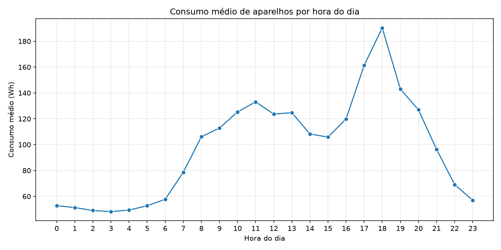
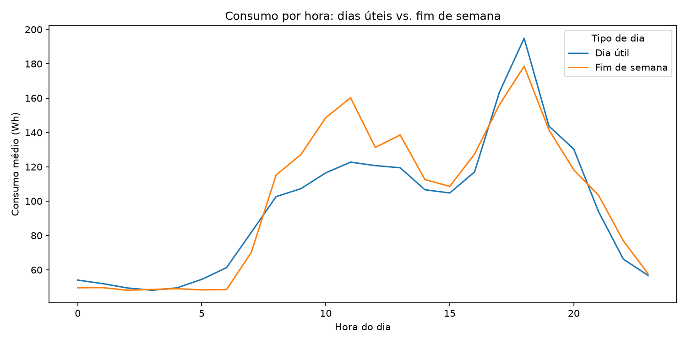
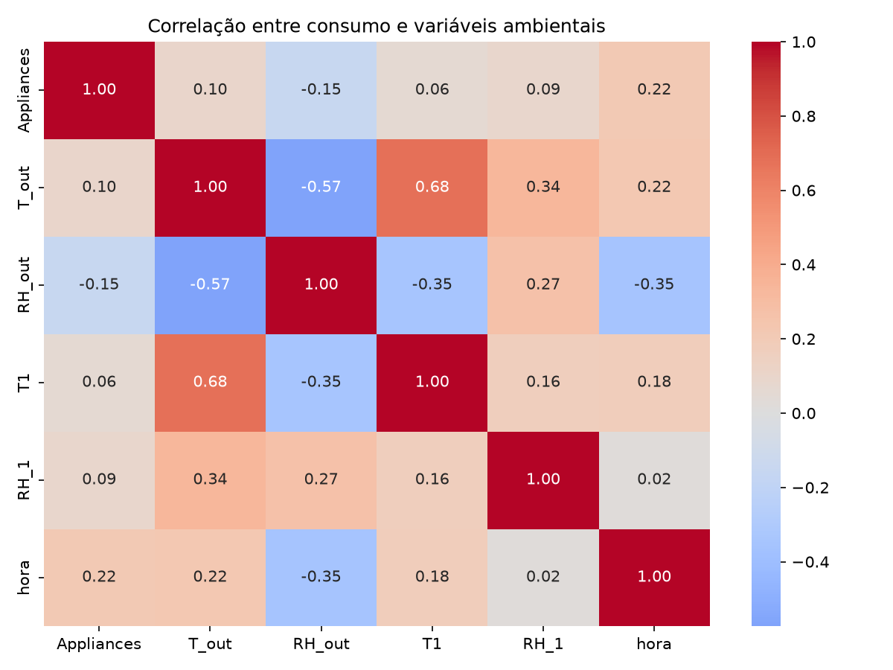
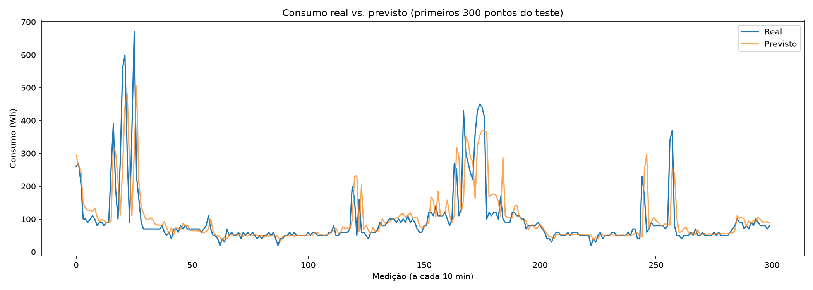
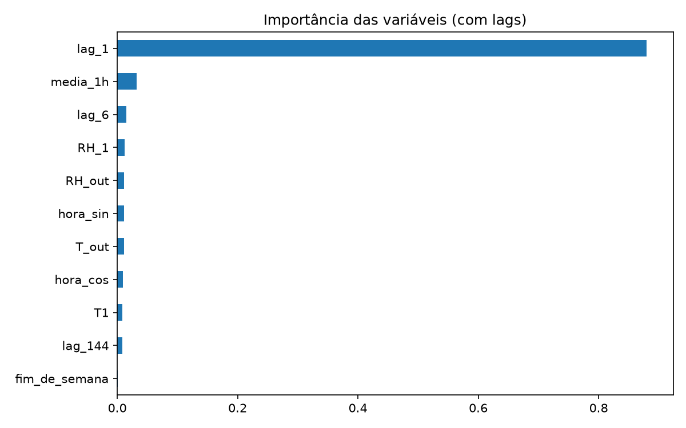

# Análise e previsão de consumo de energia residencial

Análise de como horário, tipo de dia e clima influenciam o consumo elétrico de
uma residência, e construção de modelos para prever esse consumo.

O principal resultado do projeto não foi o modelo em si, mas a descoberta de
**qual informação realmente importa**: o clima explica muito pouco do consumo,
enquanto o histórico recente derruba o erro pela metade.

---

## Principais descobertas

- **O horário é o fator mais importante.** O consumo médio vai de ~50 Wh na
  madrugada até ~190 Wh às 18h, um pico quase 4 vezes maior.
- **Dias úteis e fins de semana têm padrões diferentes.** No fim de semana há um
  pico adicional pela manhã (~160 Wh às 11h), ausente nos dias úteis.
- **O clima quase não explica o consumo.** A maior correlação com temperatura ou
  umidade foi de apenas 0,10.
- **O histórico recente é o que realmente prevê.** Ao incluir o consumo dos
  minutos anteriores, o erro médio caiu de 53,6 Wh para 26,5 Wh e o R² subiu de
  negativo para 0,54.

---

## Gráficos

### Consumo médio por hora do dia


### Dias úteis vs. fim de semana


### Correlação entre consumo e variáveis ambientais


### Consumo real vs. previsto


### Importância das variáveis


---

## Dados

**Fonte:** [UCI – Appliances Energy Prediction](https://archive.ics.uci.edu/dataset/374/appliances+energy+prediction)

- ~19.700 medições, uma a cada 10 minutos
- Período de cerca de 4,5 meses (janeiro a maio de 2016)
- Uma única residência
- Variáveis: consumo dos aparelhos (Wh), temperatura e umidade de 9 cômodos,
  e dados climáticos externos (temperatura, umidade, vento, visibilidade)

---

## Metodologia

1. **Limpeza e verificação** — checagem de nulos, tipos e distribuições
2. **Feature engineering** — extração de hora, dia da semana e tipo de dia
3. **Análise exploratória** — padrões por hora, por tipo de dia, outliers e correlações
4. **Modelagem em duas etapas:**
   - Tentativa 1: apenas clima e horário
   - Tentativa 2: incluindo lag features (histórico recente) e codificação
     cíclica da hora
5. **Validação temporal** — divisão 80/20 respeitando a ordem cronológica.
   Os dados não foram embaralhados: o modelo treina no passado e é testado no
   futuro, como aconteceria na prática.

---

## Resultados

### Tentativa 1 — apenas clima e horário

| Modelo | MAE (Wh) | RMSE (Wh) | R² |
|---|---|---|---|
| Baseline (média) | 52,7 | 91,1 | 0,000 |
| Regressão linear | 53,6 | 88,6 | 0,052 |
| Random Forest | 112,7 | 154,8 | **-1,891** |

Nenhum modelo superou o baseline. O R² negativo do Random Forest indica
overfitting: como o conjunto de teste cobre um período com temperaturas que não
aparecem no treino, o modelo não consegue extrapolar.

### Tentativa 2 — incluindo o histórico recente

| Modelo | MAE (Wh) | RMSE (Wh) | R² |
|---|---|---|---|
| Baseline (média) | 51,6 | 87,9 | -0,002 |
| Regressão linear | **26,5** | 59,7 | 0,537 |
| Random Forest | 27,7 | **59,5** | **0,541** |

O erro médio caiu pela metade. Vale notar que a regressão linear teve desempenho
praticamente idêntico ao do Random Forest, sendo muito mais simples, rápida e
fácil de explicar — seria a escolha mais sensata em produção.

A diferença entre MAE (26,5) e RMSE (59,7) mostra onde o modelo falha: acerta o
consumo do dia a dia, mas erra bastante nos picos. O RMSE pune mais os erros grandes.

---

## Limitações

- Os dados são de **uma única residência** por ~4,5 meses, então os padrões
  encontrados não se generalizam para outras casas.
- Com lag features, o modelo prevê o consumo dos **próximos 10 minutos**, não o
  de dias à frente. São problemas distintos.
- Os picos de consumo dependem de ações das pessoas (ligar forno, chuveiro,
  máquina de lavar), e essa informação não está no conjunto de dados.
- O período de teste cobre uma estação diferente do treino, o que penaliza
  modelos baseados em clima.

---

## Possíveis próximos passos

- Testar previsão com horizonte maior (1 hora ou 1 dia à frente)
- Tratar o problema como classificação: prever se haverá um pico, em vez do valor exato
- Avaliar modelos específicos de séries temporais (SARIMA, Prophet)

---

## Estrutura do projeto

```
01-Consumo-de-Energia/
├── data/                    # dados brutos (CSV da UCI)
├── images/                  # gráficos gerados
├── notebooks/
│   ├── 01_exploracao.ipynb  # análise exploratória
│   └── 02_modelo.ipynb      # modelagem e avaliação
├── requirements.txt
└── README.md
```

---

## Como rodar

```bash
git clone https://github.com/SEU_USUARIO/01-Consumo-de-Energia.git
cd 01-Consumo-de-Energia

python -m venv .venv
source .venv/Scripts/activate    # Windows (Git Bash)
# source .venv/bin/activate      # Linux / macOS

pip install -r requirements.txt
jupyter notebook
```

Os dados já estão incluídos em `data/`. Caso queira baixá-los novamente, use o
link da seção **Dados**.

---

## Tecnologias

`Python` · `pandas` · `numpy` · `matplotlib` · `seaborn` · `scikit-learn`
